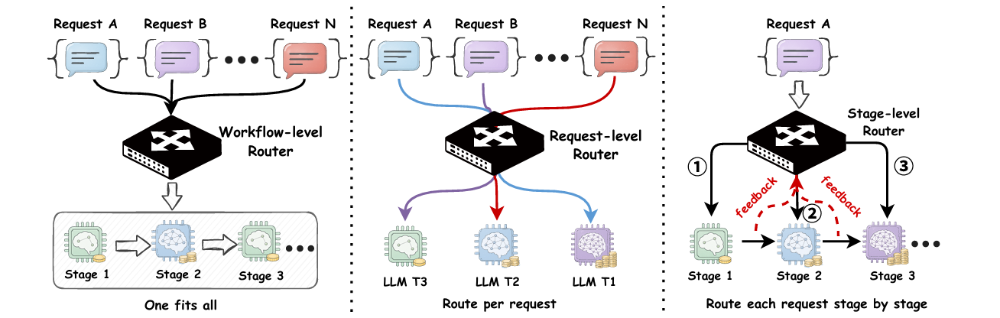
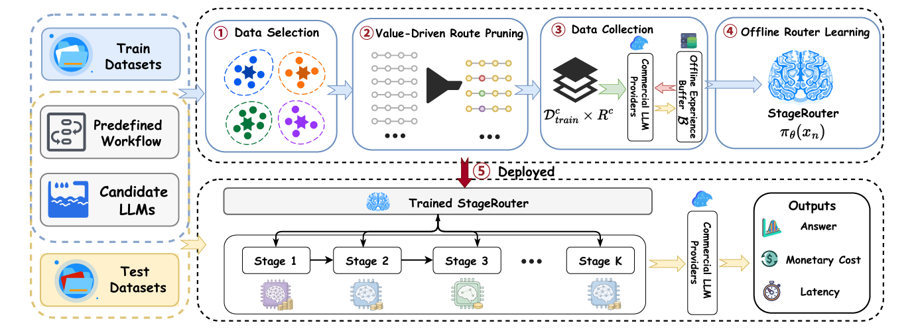

# StageRouter: Cost-Efficient Stage-wise Routing for Data Agents

> \> **Intro** Data agents often use  agentic workflows to solve data-centric tasks such as Text-to-SQL and retrieval-augmented generation (RAG). Existing methods either reuse fixed model assignments across requests or choose one LLM for an entire request, leaving them unable to adapt as intermediate results emerge. StageRouter instead makes stage-wise routing: it selects an LLM or skips an optional stage based on the information available at that point. It learns this policy from offline trajectories collected through request selection, route pruning, and prefix reuse, using a Marginal-Advantage Network and joint TD–MC training to balance final-answer quality and inference cost.



**Routing paradigms.** Unlike fixed workflow-level assignments or a single model per request, StageRouter adapts its execution decisions stage by stage using intermediate feedback.


## 🚀 Performance 

| Task / benchmark | Method | Quality | Average latency (s) | Average cost (USD) |
| --- | --- | ---: | ---: | ---: |
| Text-to-SQL / BIRD Dev | Static-T1 | EX 68.06% | 72.36 | $0.0311 |
| Text-to-SQL / BIRD Dev | **StageRouter** | **EX 68.13%** | **33.59** | **$0.0089** |
| RAG / MultiHop-RAG | Static-T1 | F1 0.613 | 75.68 | $0.00314 |
| RAG / MultiHop-RAG  | **StageRouter** | **F1 0.663** | **16.69** | **$0.00079** |

EX is execution accuracy; F1 is token-level answer F1. Cost is the average LLM API charge per request.


## 🏗️ Requirements

We recommend using Conda to manage the project environment. For example:

```
conda create -n StageRouter python=3.12.5
conda activate StageRouter

# install dependencies:
pip install -r requirements.txt
```

## 🛠️LLM Configuration

Both workflows use the following candidate LLM pool, with the fixed experimental prices in Table 2 of the paper:

| Tier | Model | Input (USD / 1M tokens) | Output (USD / 1M tokens) |
| :---: | --- | ---: | ---: |
| T1 | `qwen-plus` | 0.80 | 2.00 |
| T2 | `qwen3.5-flash` | 0.20 | 2.00 |
| T3 | `qwen-flash` | 0.15 | 1.50 |

This cost schedule reflects API pricing around April 2026 and is held fixed across experiments for consistent cost accounting.

**Despite the modest output-token price gap between the most expensive and cheapest LLM, StageRouter reduces inference costs by 71.4% on BIRD and 74.8% on MultiHop-RAG relative to Static-T1, while improving task quality.**


### Environment File

Configure **one `.env` in the repository root**, beside this README, using [`.env.example`](.env.example). Both `text-2-sql/` and `RAG/` read this file. Task-local `.env` files and the old `RAG_ENV_FILE` setting are not used. Keep real API keys private.

The two shared API settings are:

```dotenv
# Your API key, with access to the three candidate LLMs and text-embedding-v3.
LLM_API_KEY=""

# OpenAI-compatible API endpoint, including /v1.
LLM_BASE_URL="https://dashscope.aliyuncs.com/compatible-mode/v1"
```




**StageRouter overview.** Request selection and route pruning guide offline experience collection, followed by policy learning and stage-wise execution at deployment.

## 🏃 Run the Workflows

Before starting either task, complete the environment and GTE configuration above. Both tasks use the same five entry points, with paths and run settings configured in each task's `_workflow.py`; no command-line arguments are required.

### Text-to-SQL

Prepare the BIRD training and development data following the setup instructions in the [CHESS repository](https://github.com/ShayanTalaei/CHESS). Place the prepared files under `text-2-sql/data/train/` and `text-2-sql/data/dev/`, respectively.

Then run the five steps in order:

```bash
cd text-2-sql
python select_data.py      # 1. Representative data selection
python select_routes.py    # 2. Value-Driven Route pruning
python collect_buffer.py   # 3. Collect Train routes and Dev anchors
python train.py            # 4. Prepare features and train
python evaluate.py         # 5. Evaluate on Dev
```


### RAG

Prepare the benchmark data using the [MultiHop-RAG repository](https://github.com/yixuantt/MultiHop-RAG) as a reference. Place the prepared question splits at `RAG/data/train.json` and `RAG/data/test.json`, and the document corpus at `RAG/data/raw/corpus.json`.

The retrieval service is included in `RAG/retrieval/`. Start it in a separate terminal before collection or evaluation. The launcher builds the index if needed or reuses a matching existing index:

```bash
cd RAG
python start_retrieval.py
```

Keep that terminal open, then run the five steps from `RAG/` in another terminal:

```bash
python select_data.py      # 1. Representative data selection
python select_routes.py    # 2. Value-Driven Route pruning
python collect_buffer.py   # 3. Collect Train routes and Dev anchors
python train.py            # 4. Prepare features and train
python evaluate.py         # 5. Evaluate on Dev (data/test.json)
```


